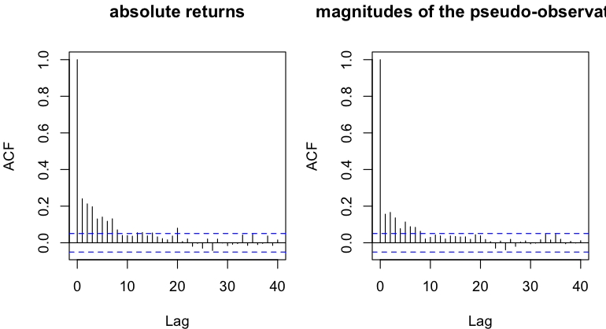
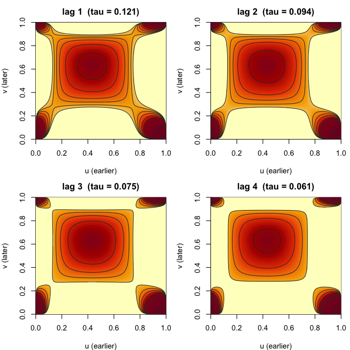
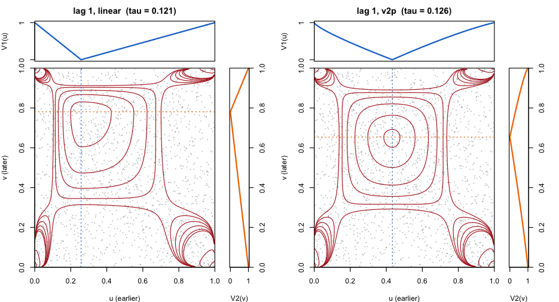
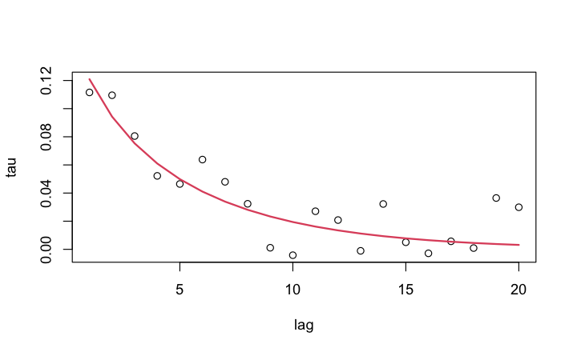
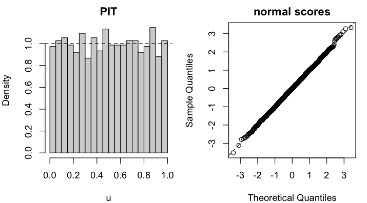
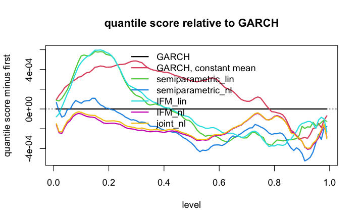

## Data

We study the daily log-returns of the VIX index. The prices are downloaded from Yahoo Finance with `quantmod` over a fixed date range, so that the analysis is reproducible, and cached locally; the data are not distributed with the package. Yahoo reports VIX values on a couple of days on which the S&P 500 was closed, which we drop so that the VIX series follows the S&P 500 trading calendar.


``` r
get_prices <- function(symbol, from, to, cache_dir = "cache") {
  file <- file.path(cache_dir, paste0(gsub("[^A-Za-z0-9]", "", symbol), ".csv"))
  if (!file.exists(file)) {
    dir.create(cache_dir, showWarnings = FALSE)
    x <- quantmod::getSymbols(symbol, from = from, to = to,
                              auto.assign = FALSE, warnings = FALSE)
    d <- data.frame(date = zoo::index(x), price = as.numeric(quantmod::Cl(x)))
    d <- d[is.finite(d$price) & d$price > 0, ]
    write.csv(d, file, row.names = FALSE)
  }
  d <- read.csv(file)
  d$date <- as.Date(d$date)
  d
}
vix <- get_prices("^VIX", from = "2018-10-25", to = "2026-10-14")
spx <- get_prices("^GSPC", from = "2018-10-25", to = "2026-10-14")
vix <- vix[vix$date %in% spx$date, ]
r <- diff(log(vix$price))
dates <- vix$date[-1]
c(n = length(r), first = format(dates[1]), last = format(dates[length(r)]))
#>            n        first         last 
#>       "2000" "2018-10-26" "2026-10-13"
```

The first 1500 returns (to 2024-10-14) are used for estimation and the last 500 are a holdout for the forecasting comparison. We work with the raw returns throughout: there is no mean model or prefilter, because the dependence of interest is in the volatility and the copula models do not need a zero-mean series.


``` r
ntr <- 1500
rtr <- r[1:ntr]
```

## Why a copula model for VIX returns?

Daily VIX returns are heavy tailed and show the familiar volatility clustering: large moves of either sign are followed by large moves. The serial dependence is therefore of "cross" form, not monotone. The returns themselves have a small negative first-order autocorrelation (about $-0.10$) and essentially none beyond lag 1, while the absolute returns are positively autocorrelated, with autocorrelations of about 0.2 at the first few lags that decay over roughly ten lags. The same holds on the copula scale, where the dependence between the *magnitudes* of the moves can be read from $|U_t - 1/2|$, with $U_t$ the rank-based pseudo-observation. The small negative lag-1 dependence is also present in the ranks (the Spearman correlation is about $-0.06$); the models below capture it through different fulcrums for the earlier and the later variable of a pair. These are the dependence structures that the models below describe.


``` r
op <- par(mfrow = c(1, 2), mar = c(4, 4, 3, 1))
acf(abs(rtr), lag.max = 40, main = "|returns|")
acf(abs(rank(rtr) / (ntr + 1) - 0.5), lag.max = 40,
    main = expression(bold("|" * U[t] - 1/2 * "|")))
```



``` r
par(op)
```

## The model

A stationary time series with continuous margins can be described by its marginal distribution $F$ and a copula process for the probability integral transforms $U_t = F(X_t)$. We model the copula process as a *D-vine* with pair copulas $c_k$ for the dependence between $U_t$ and $U_{t+k}$ given the values in between, truncated at an effective lag $K$. Two ingredients make the model suitable for volatile series:

* The pair copulas are *inverse-v-transformed* (IVT) copulas. A base copula $C^*$ with positive dependence and upper tail dependence (here the absolute spherical t copula, `ast`, in the base-copula role) is evaluated at v-transformed arguments, $c_k(u, v) = c^*(V_1(u), V_2(v))$, where $V_1$ and $V_2$ are v-shaped transformations with *fulcrums* $\delta_1$ and $\delta_2$. This produces dependence between the *magnitudes* of moves relative to the fulcrums, with different fulcrums for the earlier and the later variable.
* The strength of the dependence at lag $k$ is tied to the Kendall partial autocorrelation function (kpacf) of a Gaussian *AR-factor* process, `arfactcop`. With one factor, `ARFACT(1)`, this is the sum of a stationary AR(1) process with parameter $\lambda_1$ and white noise, a special case of an ARMA(1,1) process, with weight $w_1$ on the factor; its Kendall partial autocorrelations are positive and decay geometrically. Higher-order versions with $m$ factors, `ARFACT(m)`, mix several decay rates. The pair-copula parameters of the d-vine are calibrated so that the Kendall's tau of the base copula at lag $k$ equals the kpacf at lag $k$.

The v-transforms are either linear (the default), or two-parameter *nonlinear* transforms (`vttype = "v2p"`) with shape parameters $\kappa_1$, $\kappa_2$ for the first $L$ lags, where $L$ is determined from the Kendall partial autocorrelations; $\kappa = 1$ is the linear transform.


``` r
spec <- function(base = "ast", vttype = "linear") {
  # lags are cut off where the base-copula tau falls below 0.001, at lag 40 at most
  sdvinecop(arfactcop(order = 1), tail = pc("ivt", base = base), vttype = vttype,
            maxlag = 40, tautol = 1e-3)
}
spec("ast", "v2p")
#> object class: sdvinecop (tied mode)
#> kpacf: ARFACT(1)
#> tail family: ivt with base ast
#> effective lag: not yet determined (unspecified kpacf coefficients)
#> v-transform deltas: 0.5, 0.5
#> v-transform shapes (v2p): 1, 1
#> parameters:
#> lambda1      w1  delta1  delta2  kappa1  kappa2 
#>      NA      NA     0.5     0.5     1.0     1.0
```

## Semiparametric estimation

In the semiparametric approach the margin is estimated by the empirical distribution function and the copula is fitted to the rank-based pseudo-observations. We compare linear and nonlinear (`v2p`) v-transforms for three base copulas: `ast`, Clayton (rotated by 180 degrees, so that it has upper tail dependence) and Joe. As a point of reference, we also fit the process-level alternative `vtscop`, in which a single v-transform is applied to a d-vine process of the base copula; it appears in the information-criterion table only.


``` r
pobs <- rank(rtr) / (ntr + 1)
fit_semi <- function(sp) tsfit(pobs, sp)
fits <- list(
  "ast, linear" = fit_semi(spec("ast")),
  "ast, v2p" = fit_semi(spec("ast", "v2p")),
  "clayton180, linear" = fit_semi(spec("clayton180")),
  "clayton180, v2p" = fit_semi(spec("clayton180", "v2p")),
  "joe, linear" = fit_semi(spec("joe")),
  "joe, v2p" = fit_semi(spec("joe", "v2p")))
vtscop_ast <- vtscop(sdvinecop(arfactcop(order = 1), tail = pc("ast"),
                               maxlag = 40, tautol = 1e-3), udp::v2p(0.5, 1))
vtfit <- fit_semi(vtscop_ast)
```


``` r
aic_table(c(fits, list("vtscop, ast" = vtfit)))
#>                model loglik npar    AIC  K  L    dAIC
#> 2           ast, v2p 157.20    6 -302.4 26  9   0.000
#> 4    clayton180, v2p 155.90    6 -299.8 30 11   2.597
#> 1        ast, linear 145.55    4 -283.1 24 NA  19.296
#> 6           joe, v2p 147.15    6 -282.3 22  8  20.112
#> 5        joe, linear 142.82    4 -277.6 23 NA  24.773
#> 3 clayton180, linear 131.66    4 -255.3 24 NA  47.087
#> 7        vtscop, ast  80.49    4 -153.0 16 NA 149.416
```

The nonlinear v-transforms improve the fit for every base copula, with the `ast` base giving the lowest AIC, closely followed by Clayton. The `vtscop` alternative, which uses one transform for the whole process, fits substantially worse.

We rank models by the Akaike information criterion (AIC), which targets predictive accuracy. With 1500 observations and at most a dozen parameters the small-sample correction of AICc changes the values by less than 0.2, and BIC, with its heavier penalty of $\ln 1500 \approx 7.3$ per parameter, gives the same two leading models and the same conclusions below; it differs only in ordering some of the weaker ones (for example Joe with linear transforms ranks above Joe with v2p transforms). The semiparametric fits are maximised pseudo-likelihoods based on ranks, so their AIC values are suitable only for comparing copula models for the same data; the comparison with GARCH below uses the parametric-margin fits.

The best linear and nonlinear fits and their estimates, with standard errors from the Hessian, are shown next. The linear model is the special case $\kappa_1 = \kappa_2 = 1$ of the nonlinear one, so we can test linearity with a likelihood ratio test (two extra parameters; the effective lag $K$ and the number of nonlinear lags $L$ are chosen from the data, so the p-value is indicative).


``` r
fit_nl <- tsfit(pobs, spec("ast", "v2p"), se = "hessian")
fit_lin <- fits[["ast, linear"]]
fit_nl
#> object class: sdvinecopfit
#> kpacf: ARFACT(1)
#> tail family: ivt with base ast
#> effective lag K = 26 (tautol = 0.001); started at 24, 1 refit(s)
#> nonlinear lags L = 9 (nltau = 0.02)
#> estimates:
#>         estimate      se
#> lambda1   0.9429 0.01078
#> w1        0.2003 0.01699
#> delta1    0.4388 0.05705
#> delta2    0.6378 0.05485
#> kappa1    0.6525 0.09624
#> kappa2    1.4566 0.19435
#> standard errors: hessian
#> loglik: 157.2028  npar: 6  nobs: 1500
lr <- 2 * (logLik(fit_nl)[1] - logLik(fit_lin)[1])
c(LR = lr, p.value = pchisq(lr, df = 2, lower.tail = FALSE))
#>        LR   p.value 
#> 2.330e+01 8.736e-06
```

The Hessian standard errors do not account for the data-driven choice of $K$ and $L$, and the likelihood is not smooth where an observation crosses a fulcrum, so we also compute a parametric bootstrap with 100 replicates. Each replicate simulates a series from the fitted model, re-ranks it and refits the model, starting from the fitted values.


``` r
cores <- max(1, parallel::detectCores() - 1)
fit_boot <- tsfit(pobs, spec("ast", "v2p"), se = "bootstrap", B = 100, cores = cores)
ci <- apply(fit_boot@boot, 2, quantile, c(0.025, 0.975), na.rm = TRUE)
round(rbind(estimate = coef(fit_boot), se = fit_boot@se, ci), 3)
#>          lambda1    w1 delta1 delta2 kappa1 kappa2
#> estimate   0.943 0.200  0.439  0.638  0.653  1.457
#> se         0.009 0.023  0.054  0.057  0.093  0.211
#> 2.5%       0.929 0.160  0.327  0.536  0.511  1.150
#> 97.5%      0.961 0.263  0.530  0.742  0.818  2.016
```

### What the fitted dependence looks like

The `plot` method draws the pair copulas at the first lags as contours of the density. Each is the copula of $(U_t, U_{t+k})$ given the observations in between (the *partial* copula). The densities are cross shaped: values close to the fulcrums of the two v-transforms are positively dependent, and so are two large moves, of either sign. The dependence is not symmetric, because the fulcrums are different.


``` r
plot(fit_nl)
```



The next figure compares the linear and nonlinear models at lag 1, with the pairs of consecutive observations (as probability-integral transforms) and the two v-transforms in the strips: $V_1$ above and $V_2$ to the right, with the fulcrums marked in the panels. With linear transforms the fit puts the fulcrums at about (0.26, 0.78); the nonlinear transforms curve, and their fulcrums move to about (0.43, 0.65). The fulcrums therefore do not mean the same thing in the two models, and should not be compared directly.


``` r
plot(fit_lin, fit_nl, lags = 1, data = TRUE, strips = TRUE, fill = FALSE, labels = c("linear", "v2p"))
```



The fitted Kendall partial autocorrelations can be compared with their estimates from the data through the residuals-based "generalised lag" diagnostic `ktauhat`.


``` r
kh <- ktauhat(fit_nl)
plot(kh$lag, kh$tau_data, xlab = "lag", ylab = "tau",
     ylim = range(c(kh$tau_data, kh$tau_model)))
lines(kh$lag, kh$tau_model, col = 2, lwd = 2)
```



## Margin first: the IFM approach

In the inference-functions-for-margins (IFM) approach a parametric margin is fitted first and the copula is fitted to its probability integral transforms. The function `automarg` fits all the available families and ranks them.


``` r
am <- automarg(rtr)
head(am@table[, c("family", "npar", "loglik", "AIC", "delta")], 5)
#>   family npar loglik   AIC  delta
#> 1    nig    4   1867 -3727 0.0000
#> 2    jsu    4   1867 -3727 0.3545
#> 3     gh    5   1868 -3726 1.4002
#> 4    sst    4   1865 -3722 4.4588
#> 5    hyp    4   1864 -3719 7.5431
mg <- am@best
mg
#> object class: margfit
#> family: nig (normal inverse Gaussian)
#> estimates:
#>       mu    sigma    shape     skew 
#> -0.02382  0.07195  0.87143  0.32920 
#> loglik: 1867.47  npar: 4  nobs: 1500
```

The normal inverse Gaussian family fits best, with the Johnson SU and generalised hyperbolic families close behind; the Gaussian margin is far worse (not shown). The probability integral transforms of the fitted margin should be uniform:


``` r
u_ifm <- mdf(mg, rtr)
op <- par(mfrow = c(1, 2), mar = c(4, 4, 2, 1))
hist(u_ifm, breaks = 20, freq = FALSE, main = "PIT", xlab = "u"); abline(h = 1, lty = 2)
qqnorm(qnorm(u_ifm), main = "normal scores"); abline(0, 1, lty = 2)
```



``` r
par(op)
```

Fitting a `tsmod` model with a parametric margin first estimates the margin and then fits the copula to its probability integral transforms, so one call of `tsfit` carries out the two stages of the IFM approach. The log-likelihood and the AIC of the fitted model are those of the whole model, margin and copula, which is what we need to compare with GARCH below. We use the same copula specifications as before.


``` r
fam <- mg@model@family
fit_ifm <- function(sp) tsfit(rtr, tsmod(fam, sp))
fits_ifm <- list(
  "ast, linear" = fit_ifm(spec("ast")),
  "ast, v2p" = fit_ifm(spec("ast", "v2p")),
  "clayton180, linear" = fit_ifm(spec("clayton180")),
  "clayton180, v2p" = fit_ifm(spec("clayton180", "v2p")),
  "joe, linear" = fit_ifm(spec("joe")),
  "joe, v2p" = fit_ifm(spec("joe", "v2p")))
vtfit_ifm <- fit_ifm(vtscop_ast)
ifm_lin <- fits_ifm[["ast, linear"]]
ifm_nl <- fits_ifm[["ast, v2p"]]
```


``` r
aic_table(c(fits_ifm, list("vtscop, ast" = vtfit_ifm)))
#>                model loglik npar   AIC  K  L     dAIC
#> 2           ast, v2p   2024   10 -4029 27  9   0.0000
#> 4    clayton180, v2p   2024   10 -4028 31 11   0.4148
#> 6           joe, v2p   2012   10 -4005 22  8  24.0649
#> 1        ast, linear   2010    8 -4004 24 NA  24.5813
#> 5        joe, linear   2005    8 -3994 22 NA  34.4853
#> 3 clayton180, linear   1999    8 -3981 24 NA  47.3893
#> 7        vtscop, ast   1946    8 -3876 16 NA 152.4593
```

The picture is the same as for the semiparametric fits: the nonlinear transforms help for every base, and `ast` and Clayton are close. The estimates of the best model barely change with the margin:


``` r
round(rbind(semiparametric = coef(fit_nl), IFM = coef(ifm_nl@copfit)), 3)
#>                lambda1    w1 delta1 delta2 kappa1 kappa2
#> semiparametric   0.943 0.200  0.439  0.638  0.653  1.457
#> IFM              0.944 0.191  0.445  0.623  0.618  1.567
```

## The full model: joint maximum likelihood

Finally, the margin and the copula process can be estimated together by maximising the joint likelihood of the series. The two-stage estimates are the starting values.


``` r
full <- tsfit(rtr, tsmod(fam, spec("ast", "v2p")), method = "joint", se = "hessian")
full
#> object class: tsmodfit   (method: joint)
#> margin:
#>   object class: margfit
#>   family: nig (normal inverse Gaussian)
#>   estimates:
#>         mu    sigma    shape     skew 
#>   -0.02376  0.07223  0.82049  0.32781 
#>   loglik: 1867.387  npar: 4  nobs: 1500
#> copula process:
#>   object class: sdvinecop (tied mode)
#>   kpacf: ARFACT(1)
#>   tail family: ivt with base ast
#>   effective lag K = 27 (tautol = 0.001)
#>   nonlinear lags L = 9 (nltau = 0.02)
#>   v-transform deltas: 0.4481, 0.6254
#>   v-transform shapes (v2p): 0.6246, 1.5456
#>   parameters:
#>   lambda1      w1  delta1  delta2  kappa1  kappa2 
#>    0.9445  0.1933  0.4481  0.6254  0.6246  1.5456 
#> combined estimates (standard errors: hessian):
#>                estimate       se
#> margin.mu      -0.02376 0.003054
#> margin.sigma    0.07223 0.004599
#> margin.shape    0.82049 0.168407
#> margin.skew     0.32781 0.047760
#> copula.lambda1  0.94445 0.010746
#> copula.w1       0.19333 0.021384
#> copula.delta1   0.44813 0.058968
#> copula.delta2   0.62539 0.056298
#> copula.kappa1   0.62458 0.098016
#> copula.kappa2   1.54556 0.217791
#> loglik: 2024.502  npar: 10  nobs: 1500
c(two_stage = logLik(ifm_nl)[1], joint = logLik(full)[1])
#> two_stage     joint 
#>      2024      2025
```

The joint estimation improves the log-likelihood only slightly, and the estimates are similar to those of the two-stage approach: the data are informative about the margin, so there is little to gain from estimating the two parts together.

## Comparison with GARCH in sample

As a benchmark we fit GARCH(1,1) and GJR-GARCH(1,1) models with six innovation distributions and three conditional mean models: a constant, an AR(1) and an ARMA(1,1). The mean models matter here because of the negative first-order autocorrelation of the returns noted above. We use the `rugarch` package and select by AIC; the helper functions are listed in the appendix.


``` r
garch_grid <- expand.grid(model = c("sGARCH", "gjrGARCH"),
                          dist = c("norm", "std", "sstd", "ged", "jsu", "nig"),
                          meanmod = c("(0,0)", "(1,0)", "(1,1)"),
                          stringsAsFactors = FALSE)
gfits <- lapply(seq_len(nrow(garch_grid)), function(i)
  garch_fit(rtr, garch_grid[i, ]))
garch_tab <- cbind(garch_grid, t(sapply(gfits, ic)))
head(garch_tab[order(garch_tab$AIC), ], 5)
#>       model dist meanmod loglik npar   AIC
#> 34 gjrGARCH  jsu   (1,1)   2003    9 -3987
#> 36 gjrGARCH  nig   (1,1)   2001    9 -3985
#> 33   sGARCH  jsu   (1,1)   1999    8 -3982
#> 30 gjrGARCH sstd   (1,1)   2000    9 -3981
#> 35   sGARCH  nig   (1,1)   1998    8 -3981
best <- which.min(garch_tab$AIC)
best_g <- garch_tab[best, ]
gbest <- gfits[[best]]
coef(gbest)
#>         mu        ar1        ma1      omega     alpha1      beta1     gamma1 
#>  0.0001795  0.7341393 -0.8284436  0.0003874  0.1598442  0.8318184 -0.1437150 
#>       skew      shape 
#>  1.2963681  1.7871900
# the best model with a constant mean, for comparison
best0 <- which.min(ifelse(garch_tab$meanmod == "(0,0)", garch_tab$AIC, Inf))
best_g0 <- garch_tab[best0, ]
gbest0 <- gfits[[best0]]
```

The best model is a GJR-GARCH model with Johnson SU innovations and an ARMA(1,1) conditional mean, which improves the AIC by about 20 over the best constant-mean model. The AR and MA coefficients, $0.73$ and $-0.83$, are close to cancelling, so the mean equation is a small correction: a first-order autocorrelation of about $-0.1$ that decays slowly. (Estimates from longer windows, in the rolling section below, show an even closer cancellation.) The asymmetry parameter of the GJR model captures the leverage-type effect; for the copula models the corresponding feature is the difference between the two fulcrums of the v-transforms, and the copula models have no mean equation. The AIC of a fitted copula model with a parametric margin is that of the whole model, margin and copula, so it is comparable with the AIC of the GARCH models.


``` r
models <- list("GARCH, best" = gbest, "GARCH, best constant mean" = gbest0,
               "IFM, linear" = ifm_lin, "IFM, v2p" = ifm_nl, "joint, v2p" = full)
insample <- t(sapply(models, ic))
round(cbind(insample, dAIC = insample[, "AIC"] - insample[1, "AIC"]), 2)
#>                           loglik npar   AIC   dAIC
#> GARCH, best                 2003    9 -3987   0.00
#> GARCH, best constant mean   1990    7 -3967  20.47
#> IFM, linear                 2010    8 -4004 -16.89
#> IFM, v2p                    2024   10 -4029 -41.47
#> joint, v2p                  2024   10 -4029 -41.66
```

In sample the nonlinear copula model fits much better than the best GARCH model (AIC lower by 41) and the linear copula model also has the lower AIC (by 17), although the margin is smaller than against the constant-mean GARCH model (20 points). This in-sample advantage is not the same as forecasting accuracy, so we now compare out-of-sample forecasts.

## Out-of-sample comparison with fixed parameters

For each of the 500 holdout days we compute the one-step-ahead predictive distribution given all the data to the previous day, with the parameters fixed at their estimates from the estimation period. `tsroll` returns the predictive quantiles, the log predictive density and the lower-tail value-at-risk and expected shortfall; `tsscore` scores them. We use the average quantile score (AQS, the pinball loss averaged over 99 equally spaced levels: smaller is better), value-at-risk backtests, and Diebold-Mariano tests with Newey-West standard errors. The GARCH forecasts are supplied as a matrix of predictive quantiles, which `tsscore` also accepts.


``` r
lev <- (1:99) / 100
start <- ntr + 1
em <- emarg(rtr)
fc <- list(
  semiparametric_lin = tsroll(tsmod(em, fit_lin@model), r, start = start),
  semiparametric_nl = tsroll(tsmod(em, fit_nl@model), r, start = start),
  IFM_lin = tsroll(ifm_lin, r, start = start),
  IFM_nl = tsroll(ifm_nl, r, start = start),
  joint_nl = tsroll(full, r, start = start))
garch <- garch_quantiles(coef(gbest), r, best_g, lev)[start:length(r), ]
garch0 <- garch_quantiles(coef(gbest0), r, best_g0, lev)[start:length(r), ]
y <- r[start:length(r)]
sc <- do.call(tsscore, c(list(x = garch, GARCH_const_mean = garch0), fc,
                         list(observed = y, levels = lev, p = c(0.01, 0.05))))
sc$summary$forecast[1] <- "GARCH"
```


``` r
tab <- sc$summary[, c("forecast", "aqs")]
tab$aqs_x1000 <- 1000 * tab$aqs
tab$vs_garch_pct <- 100 * (tab$aqs / tab$aqs[1] - 1)
v1 <- sc$var[["0.01"]]; v5 <- sc$var[["0.05"]]
tab$breaches_1pct <- v1$breaches; tab$kupiec_p_1pct <- v1$kupiec.p
tab$breaches_5pct <- v5$breaches; tab$kupiec_p_5pct <- v5$kupiec.p
dm <- sc$dm[sc$dm$loss == "aqs", c("forecast", "statistic", "p.value")]
tab$DM_stat <- c(NA, dm$statistic); tab$DM_p <- c(NA, dm$p.value)
tab$aqs <- NULL
print(tab, digits = 3, row.names = FALSE)
#>            forecast aqs_x1000 vs_garch_pct breaches_1pct kupiec_p_1pct
#>               GARCH      20.8      0.00000            11        0.0199
#>    GARCH_const_mean      21.0      0.96958            11        0.0199
#>  semiparametric_lin      20.8     -0.06921             9        0.1060
#>   semiparametric_nl      20.6     -0.96257             9        0.1060
#>             IFM_lin      20.8     -0.00612             7        0.3966
#>              IFM_nl      20.6     -0.93982             8        0.2149
#>            joint_nl      20.6     -0.88606             8        0.2149
#>  breaches_5pct kupiec_p_5pct  DM_stat   DM_p
#>             25         1.000       NA     NA
#>             27         0.685 -1.68767 0.0915
#>             23         0.678  0.11371 0.9095
#>             29         0.423  1.65502 0.0979
#>             23         0.678  0.00872 0.9930
#>             28         0.546  1.29305 0.1960
#>             28         0.546  1.25743 0.2086
```

The Diebold-Mariano statistic is the mean difference in AQS between the first forecast (the best GARCH model) and the other one, so positive values favour the other model; the `GARCH_const_mean` row compares the two GARCH models. Expected numbers of breaches are 5 at the 1% level and 25 at the 5% level over the 500 days.

With the ARMA mean the GARCH model is about 1% better in AQS than with a constant mean (DM $p = 0.09$). The nonlinear copula models are about 0.9 to 1.0% better than the best GARCH model, which is not significant at conventional levels (DM $p = 0.10$ for the semiparametric version and about 0.2 for the IFM and joint versions), and the linear copula models are level with GARCH. The value-at-risk backtests are as before: the GARCH models have 11 breaches at the 1% level, which the Kupiec test rejects ($p = 0.02$), while the copula models are not rejected at either level.


``` r
colnames(sc$profile)[1:2] <- c("GARCH", "GARCH, constant mean")
plot(sc, relative = TRUE, main = "quantile score relative to GARCH")
```



Among the copula models themselves the log predictive density is also available, since their forecasts include the margin. Here `neglogscore` is the negative log predictive density (smaller is better). The log scores are only comparable between models with the same margin, because the semiparametric forecasts use a kernel density estimate for the margin: we compare the linear and nonlinear semiparametric models, and then the three versions of the parametric-margin models. The Diebold-Mariano statistics compare each model with the first in its group; positive values favour the other model.


``` r
semiparametric_lin <- fc$semiparametric_lin
semiparametric_nl <- fc$semiparametric_nl
IFM_lin <- fc$IFM_lin; IFM_nl <- fc$IFM_nl; joint_nl <- fc$joint_nl
sc_semi <- tsscore(semiparametric_lin, semiparametric_nl)
sc_par <- tsscore(IFM_lin, IFM_nl, joint_nl)
cols <- c("forecast", "aqs", "neglogscore")
rbind(sc_semi$summary[, cols], sc_par$summary[, cols])
#>             forecast     aqs neglogscore
#> 1 semiparametric_lin 0.02081      -1.142
#> 2  semiparametric_nl 0.02063      -1.161
#> 3            IFM_lin 0.02082      -1.232
#> 4             IFM_nl 0.02063      -1.257
#> 5           joint_nl 0.02064      -1.256
cols <- c("forecast", "diff", "statistic", "p.value")
rbind(sc_semi$dm[sc_semi$dm$loss == "neglogscore", cols],
      sc_par$dm[sc_par$dm$loss == "neglogscore", cols])
#>             forecast    diff statistic  p.value
#> 2  semiparametric_nl 0.01950     2.734 0.006261
#> 21            IFM_nl 0.02539     2.802 0.005081
#> 6           joint_nl 0.02433     2.688 0.007196
```

The nonlinear semiparametric model is clearly better than the linear one on the log score ($p \approx 0.006$), and the same holds for the parametric-margin models, where the joint fit is no better than two-stage.

## Rolling re-estimation

The comparison so far used parameters fixed at the estimation-period values. To see whether stale parameters matter, we re-estimate every 20 days on an expanding window, starting each fit from the previous estimates; the model structure is kept. We do this for the semiparametric models, whose refits are quickest, and for the best GARCH model.


``` r
roll <- list(
  semiparametric_lin = tsroll(tsmod(em, fit_lin@model), r, start = start, refit = 20),
  semiparametric_nl = tsroll(tsmod(em, fit_nl@model), r, start = start, refit = 20))
garch_r <- garch_roll(r, best_g, start, cf0 = coef(gbest))
scr <- do.call(tsscore, c(list(x = garch_r), roll,
                          list(observed = y, levels = lev, p = c(0.01, 0.05))))
```


``` r
scr$summary$forecast[1] <- "GARCH"
tabr <- scr$summary[, c("forecast", "aqs")]
tabr$aqs_fixed_x1000 <- 1000 * sc$summary$aqs[match(tabr$forecast, sc$summary$forecast)]
tabr$aqs_rolling_x1000 <- 1000 * tabr$aqs
tabr$vs_garch_pct <- 100 * (tabr$aqs / tabr$aqs[1] - 1)
dmr <- scr$dm[scr$dm$loss == "aqs", c("forecast", "statistic", "p.value")]
tabr$DM_stat <- c(NA, dmr$statistic); tabr$DM_p <- c(NA, dmr$p.value)
tabr$aqs <- NULL
print(tabr, digits = 3, row.names = FALSE)
#>            forecast aqs_fixed_x1000 aqs_rolling_x1000 vs_garch_pct DM_stat
#>               GARCH            20.8              20.7        0.000      NA
#>  semiparametric_lin            20.8              20.8        0.440   -0.81
#>   semiparametric_nl            20.6              20.6       -0.255    0.43
#>   DM_p
#>     NA
#>  0.418
#>  0.667
```

With re-estimation the GARCH model improves further: the advantage of the nonlinear copula model shrinks to 0.3% (DM $p = 0.67$) and the linear copula model is slightly worse than GARCH. The refits show why. The ARMA coefficients estimated from the first 1500 observations ($0.73$ and $-0.83$) differ from those estimated on windows of 1520 or more observations, which are close to $0.92$ and $-0.98$, an even closer cancellation: the fixed-parameter GARCH forecasts therefore use mean parameters that are not representative of the later windows. A mean equation of this kind models a small negative autocorrelation of the returns that decays slowly.

## Summary

The main attraction of the copula models is not forecasting accuracy, where a well-specified GARCH model is hard to beat, but that they separate the two parts of the dynamics and expose each of them explicitly. The margin is modelled and checked on its own: here a skewed, heavy-tailed normal inverse Gaussian distribution, whose fit is assessed through the probability integral transform. The serial dependence is described by a few interpretable quantities: the Kendall partial autocorrelations, which fall from 0.12 at lag 1 to 0.06 at lag 4 and are governed by the decay rate $\lambda_1 = 0.94$ and the weight $w_1 = 0.20$ of the factor; the fulcrums, 0.44 and 0.64, whose difference expresses the asymmetry between the earlier and the later observation of a pair; and the shape parameters, which show how the dependence between large moves departs from a simple v-shape. The pair-copula plots display this dependence directly, lag by lag. In a GARCH model the same information is folded into the variance recursion and the innovation distribution. The split also lets us estimate, replace or check the margin and the dependence separately, by an empirical distribution, a parametric margin, or both together.

The comparison with GARCH gives the following results.

* In sample the copula models describe the data better than GARCH even with an ARMA(1,1) mean (AIC lower by 17 for the linear and by 41 for the nonlinear model), and the nonlinear transforms are clearly supported: the likelihood ratio test of linearity gives $p \approx 10^{-5}$ and the bootstrap intervals for $\kappa_1$ and $\kappa_2$ exclude 1.
* Out of sample with fixed parameters the nonlinear copula models are about 1% better in average quantile score than the best GARCH model with a conditional mean, which is not significant ($p$ between 0.10 and 0.21), and the linear copula models are level with GARCH. The GARCH models underestimate the 1% value-at-risk (11 breaches against 5 expected, rejected by the Kupiec test), while the copula models are not rejected at either level.
* With rolling re-estimation GARCH catches up: the advantage of the nonlinear copula model falls to 0.3% ($p = 0.67$). The advantage with fixed parameters is partly due to mean-equation parameters that were not representative of the later data.
* The estimation approaches (semiparametric, IFM, joint) give very similar results here.

These results are for one series and a single holdout period of 500 days, the effective lag $K \approx 26$ is below the cap of 40 that we imposed, and VIX was chosen as the example because it illustrates the nonlinear features well. In a wider study of eight daily return series (three stocks, two equity indices, two cryptocurrencies and VIX), which we do not show here, the copula models were statistically indistinguishable out of sample from a well-chosen GARCH model with a conditional mean on every series. For VIX the nonlinear copula models were about 1% better in average quantile score (with $p$-values between 0.07 and 0.22 for fixed parameters), which is not significant at the 5% level, and the advantage vanishes with rolling re-estimation. VIX is shown here because it illustrates the nonlinear features of the models, not as evidence that they outperform GARCH.

## Appendix: the GARCH helper functions


``` r
library(rugarch)

# the fitted d-vine copula of a tscop fit (a vtscop model: its base d-vine)
cop_of <- function(f) {
  m <- if (is(f, "tsmodfit")) f@copfit@model else f@model
  if (is(m, "vtscop")) m@base else m
}
# log-likelihood, number of parameters and AIC of a fitted model, tscop or rugarch
# (rugarch reports the AIC per observation)
ic <- function(f) {
  if (is(f, "uGARCHfit")) {
    c(loglik = likelihood(f), npar = length(coef(f)),
      AIC = infocriteria(f)["Akaike", 1] * length(residuals(f)))
  } else {
    c(loglik = logLik(f)[1], npar = attr(logLik(f), "df"), AIC = AIC(f))
  }
}
# AIC table of a list of fitted copula models, with the effective lag K and the
# number of nonlinear lags L
aic_table <- function(fits) {
  tab <- data.frame(model = names(fits), t(sapply(fits, ic)),
                    K = sapply(fits, function(f) cop_of(f)@K),
                    L = sapply(fits, function(f) cop_of(f)@L), row.names = NULL)
  tab$dAIC <- tab$AIC - min(tab$AIC)
  tab[order(tab$AIC), ]
}

# g describes a GARCH model: the variance model, the innovation distribution and
# the conditional mean model as a string "(p,q)" for the ARMA orders
garch_spec <- function(g) {
  arma <- as.numeric(strsplit(gsub("[()]", "", g$meanmod), ",")[[1]])
  ugarchspec(variance.model = list(model = g$model),
             mean.model = list(armaOrder = arma),
             distribution.model = g$dist)
}
garch_fit <- function(x, g) {
  f <- tryCatch(ugarchfit(garch_spec(g), x, solver = "hybrid"),
                error = function(e) NULL)
  if (is.null(f) || f@fit$convergence != 0) NULL else f
}
# predictive quantiles (one row per observation, one column per level) of the
# observations in `x`, from the coefficients `cf` of a fit; the filter is run over
# the whole series `x`
garch_quantiles <- function(cf, x, g, levels) {
  sp <- garch_spec(g)
  setfixed(sp) <- as.list(cf)
  fl <- ugarchfilter(sp, x)
  s <- as.numeric(sigma(fl))
  mu <- x - as.numeric(residuals(fl))
  skew <- if ("skew" %in% names(cf)) cf[["skew"]] else 1
  shape <- if ("shape" %in% names(cf)) cf[["shape"]] else 5
  mu + outer(s, qdist(g$dist, levels, skew = skew, shape = shape))
}
# rolling re-estimation: refit every H observations and forecast the next block
garch_roll <- function(x, g, start, H = 20, levels = (1:99) / 100, cf0 = NULL) {
  n <- length(x)
  Q <- matrix(NA_real_, n - start + 1, length(levels))
  cf <- cf0
  for (b0 in seq(start, n, by = H)) {
    idx <- b0:min(b0 + H - 1, n)
    if (!is.null(cf0) && b0 > start || is.null(cf)) {
      f <- garch_fit(x[1:(b0 - 1)], g)
      if (!is.null(f)) cf <- coef(f)
    }
    q <- garch_quantiles(cf, x[1:max(idx)], g, levels)
    Q[idx - start + 1, ] <- q[idx, ]
  }
  Q
}
```
